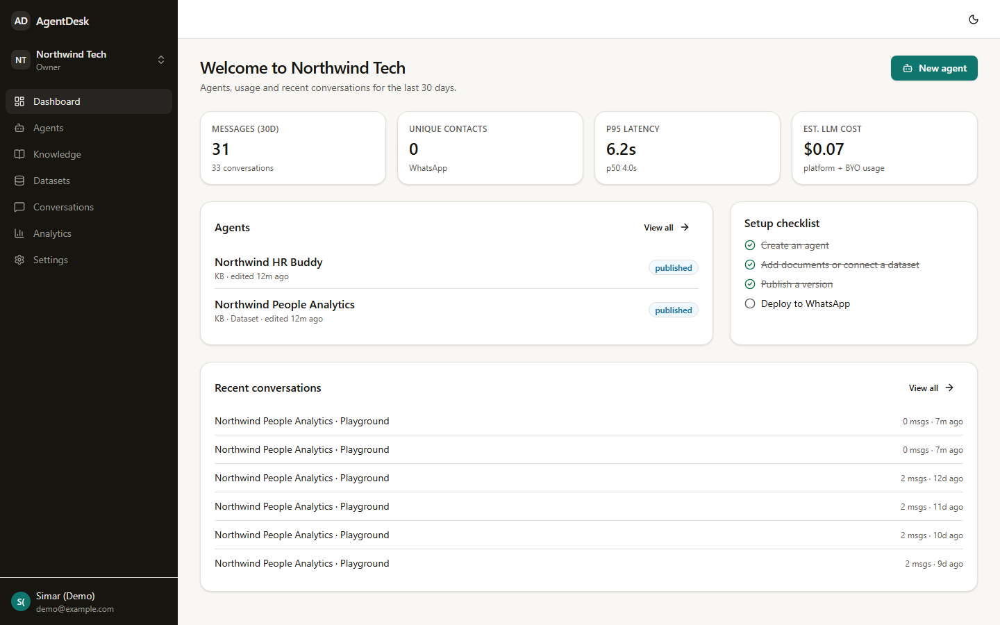
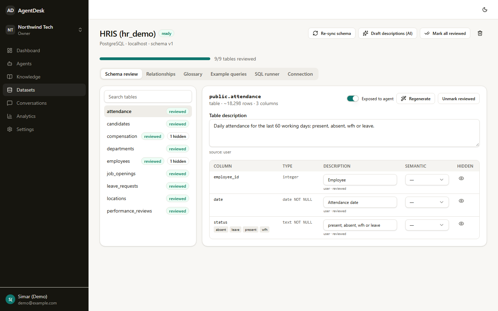
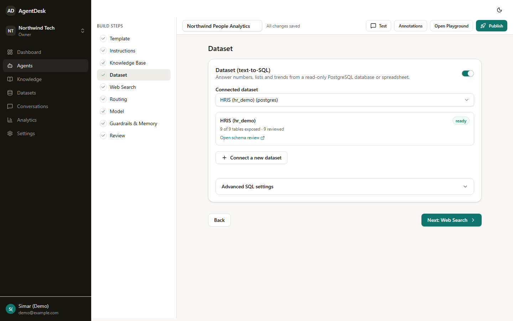
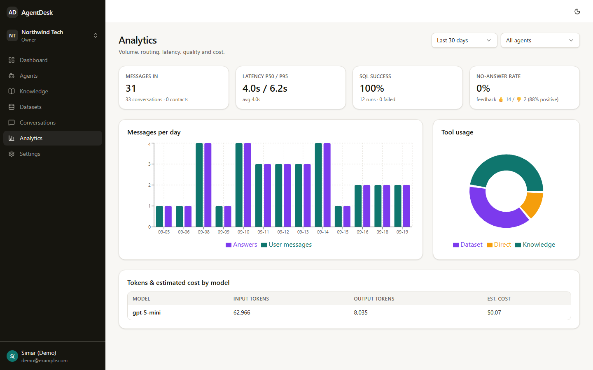
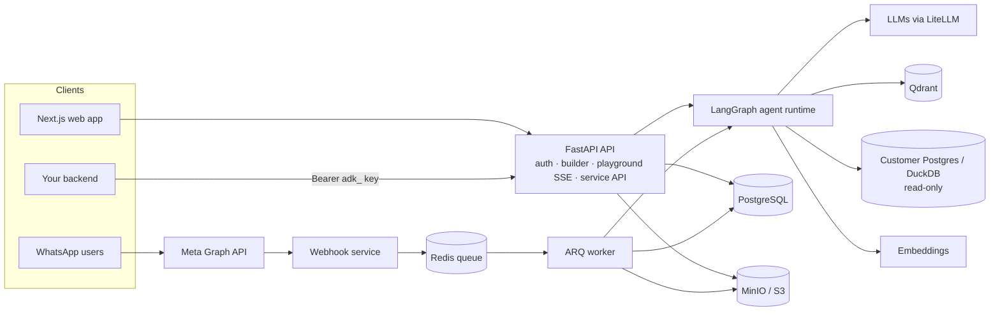

<div align="center">

# AgentDesk

**Build AI agents that answer from your documents and your database, then put them on WhatsApp or behind an API. No code required.**

[](https://github.com/AnshSingh30/AgentDesk/actions/workflows/ci.yml)
[](LICENSE)


</div>

AgentDesk is a self-hostable platform for building company assistants. Pick a template (or start blank),
upload documents, connect a read-only PostgreSQL database or spreadsheets, and test everything in a
Playground that shows exactly what the agent did. Then publish a version and deploy it to a WhatsApp
Cloud API number or call it from your own backend.

It was built for teams without an AI engineer, such as HR, school front offices and operations, and it
keeps the parts a production system needs: multi-tenancy, RBAC, encrypted secrets, a read-only SQL
safety layer, audit logs, usage metering, tracing, and an evaluation suite with recorded results.

<p align="center">
  
  
  
  
</p>

## Features

**Agents**
- Templates: *HR Onboarding* (policy Q&A), *HR Analytics* (text-to-SQL), *School Parent Helpdesk* (English + Hinglish), or blank
- A guided builder with autosave and conflict detection, immutable published versions with diffs, and rollback
- Automatic routing between **knowledge base**, **SQL dataset** and **web search**, including several tools at once. The router's decision and reason are always visible
- Guardrails: prompt-injection defence, allowed and blocked topics, no-answer policy, secret scrubbing, optional grounding check. Memory: turn window, token budget, session timeout
- **Annotation replies**: curated answers returned verbatim for similar questions, with no model call ([docs](docs/annotations.md))

**Knowledge base (RAG)**
- PDF, DOCX, TXT and Markdown. Layout-aware parsing keeps tables and page numbers
- Hybrid dense + BM25 search in Qdrant with a relevance threshold, optional reranking, and page-level citations
- Embeddings in-process, from a self-hosted [text-embeddings-inference](https://github.com/huggingface/text-embeddings-inference) container (included), or from a hosted provider

**Datasets (text-to-SQL)**
- Connect PostgreSQL read-only or upload Excel/CSV (loaded into DuckDB). The schema is introspected automatically and table/column descriptions are AI-drafted, then reviewed by you
- Hidden columns, a business glossary and example queries
- Every generated query passes an AST-level validator (single read-only `SELECT`, table allowlist, hidden columns, function denylist, `LIMIT`) and runs in a read-only transaction. 100 adversarial test cases

**Channels**
- **Playground**: streaming chat with a debug panel (route, retrieved chunks with scores, SQL attempts, guardrail events, tokens, latency) and a WhatsApp preview
- **WhatsApp Cloud API**: signed webhooks, dedupe, per-contact ordering and rate limits, formatting and message splitting
- **Service API**: per-agent API keys, blocking JSON or SSE streaming, conversations scoped to your end-user id ([docs](docs/service-api.md))

**Models**
- OpenAI, Anthropic, Gemini, Groq and OpenRouter through LiteLLM
- Any OpenAI-compatible server (vLLM, Ollama, LM Studio, gateways) as the platform default or per agent
- Customers can bring their own keys. A deterministic demo model means everything runs without a key

**Operations**
- Organisations, roles (Owner/Admin/Editor/Viewer), invitations, an audit log, usage metering and analytics
- Conversation transcripts with traces, and an operator console
- Docker Compose for development and production (Caddy TLS), Prometheus metrics, LangSmith tracing, backups

## Architecture



A message flows through `input_guardrails → annotation_reply → query_rewrite → router → [rag ‖ sql ‖ web]
→ collect_context → generate_answer → output_guardrails → channel_formatter`. Details are in
[docs/architecture.md](docs/architecture.md).

## Quick start

Prerequisites: Docker, [uv](https://docs.astral.sh/uv/), Node 22+ with pnpm (`corepack enable`), and
`make` (on Windows, use Git Bash or WSL).

```bash
git clone https://github.com/AnshSingh30/AgentDesk.git && cd AgentDesk
make install     # Python 3.12 env via uv + web dependencies; creates .env files
make dev         # infra in Docker; API :8000, webhook :8001, worker and web :3000 run natively
make seed        # (new terminal) demo orgs, 3 agents, ingested documents, HR dataset, sample conversations
```

Open http://localhost:3000 and sign in as `demo@example.com` / `Demo-password-123!`. Verification
and invitation emails land in Mailpit at http://localhost:8025.

Out of the box the agents use `fake/chat`, a deterministic demo model: routing, retrieval, SQL and
guardrails all run for real, but the answers are canned. For real answers, set a model in `.env` and
`apps/api/.env`:

```bash
DEFAULT_CHAT_MODEL=openai/gpt-5-mini        # or anthropic/claude-sonnet-5, gemini/gemini-2.5-flash, ...
OPENAI_API_KEY=sk-...
# or any OpenAI-compatible server:
# DEFAULT_CHAT_MODEL=openai/<model>  DEFAULT_LLM_API_BASE=http://localhost:8000/v1
```

See [docs/configuration.md](docs/configuration.md) for every option, including the self-hosted
embeddings server.

### Try the Service API

Publish an agent, create a key on its **Deploy** page, then:

```bash
curl -X POST http://localhost:8000/v1/service/chat \
  -H "Authorization: Bearer adk_..." -H "Content-Type: application/json" \
  -d '{"message": "How many casual leaves do I get?", "user": "employee-42"}'
```

## Quality

| Suite | Command | What it checks |
|---|---|---|
| Unit | `make test-unit` | SQL validator (100 cases), guardrails, formatter, memory trimming, crypto, gateway |
| Integration | `make test` | Real Postgres/Redis/Qdrant/MinIO: tenant isolation on every endpoint, webhooks, SQL agent, memory, Service API, annotations |
| Evals | `make evals` | 98 cases over the three templates with a live model: routing, facts and SQL values against ground truth, groundedness (LLM judge), declines, hidden-column privacy, latency |
| E2E | `make e2e` / `make smoke` | Playwright smoke test / full signup → publish flow against a running stack |

<!-- EVAL-RESULTS:START -->
Eval results are recorded in [apps/api/tests/evals/reports/SUMMARY.md](apps/api/tests/evals/reports/SUMMARY.md).
<!-- EVAL-RESULTS:END -->

Method and metrics are described in [docs/evaluation.md](docs/evaluation.md).

## Repository layout

```
apps/api      FastAPI API, webhook service, ARQ worker, LangGraph runtime, RAG and SQL pipelines, tests
apps/web      Next.js 15 app (TypeScript, Tailwind, TanStack Query)
infra         Docker Compose, Dockerfiles, Caddy, seed / backup / restore scripts
demo          Generated demo documents and the hr_demo database
docs          Documentation, ADRs and runbooks
```

## Running in production

`make prod-up` builds the images and starts the `prod` Compose profile behind Caddy with automatic TLS.
Set `APP_ENV=production` and real secrets first. The API refuses to start with development secrets.
Runbooks are in [docs/runbooks](docs/runbooks). Production use requires a commercial license while the
Business Source License applies (see below).

## Documentation

Start at [docs/README.md](docs/README.md): configuration, Service API, annotations, architecture,
security model, evaluation, help pages and runbooks.

## Contributing

Issues and pull requests are welcome. Read [CONTRIBUTING.md](CONTRIBUTING.md) first, and report
vulnerabilities privately as described in [SECURITY.md](SECURITY.md). This project follows the
[Code of Conduct](CODE_OF_CONDUCT.md).

## License

AgentDesk is source-available under the [Business Source License 1.1](LICENSE).

- **Allowed**: using, copying, modifying and redistributing AgentDesk for development, testing,
  evaluation, learning and other non-production use, including running it locally.
- **Not allowed without a commercial license**: production use.
- Each version automatically becomes available under the **Apache License 2.0** four years after its
  release (the Change Date for the current version is 2030-09-19).

For production licensing, open an issue.